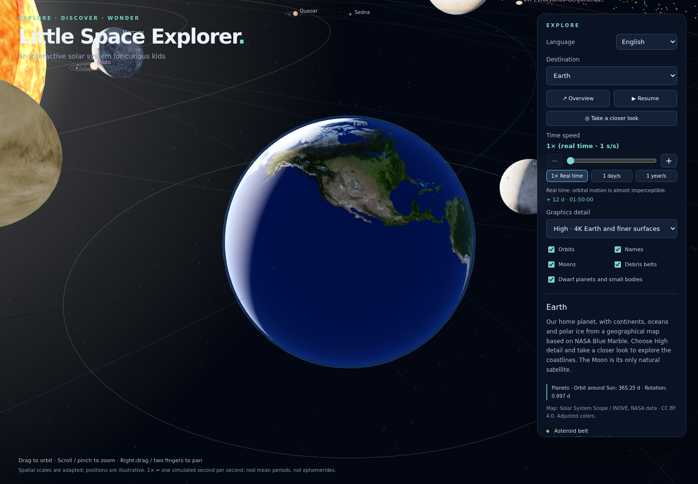

# Little Space Explorer

**An interactive solar system for curious kids**

[**Explore online →**](https://smartm0use.github.io/little-space-explorer/)

[](https://smartm0use.github.io/little-space-explorer/)

Explore **55 celestial bodies** in your browser: the Sun, eight planets,
30 moons, five recognized dwarf planets, and a selection of asteroids,
comets and distant worlds. Built with Three.js and WebGL.

## Features

- Rotate, zoom, pan and follow any body; mouse and touch controls.
- Planetary maps in 2K, with a 4K Earth option showing real continents.
- Planetary rings, the asteroid belt and the Kuiper belt.
- Pause and stepped speeds from **1× real time** to **one year per second**.
- **English and Italian**, including body descriptions and credits.
  English is the default; an Italian browser selects Italian on first use.
  The language selector saves your choice on that browser when storage is available.

Sizes, distances and initial positions are illustrative, not current
ephemerides. Orbital and rotational periods are approximate real values;
not every known body is included. See the [model notes and credits](https://smartm0use.github.io/little-space-explorer/credits.html).

## Run locally

With Python 3 installed:

```bash
python3 avvia_browser.py
```

The launcher opens your browser. Keep the terminal running; press Ctrl+C to
stop. Alternatively, serve `web/` with any static HTTP server. Opening
`index.html` directly with `file://` will not work with JavaScript modules.
All runtime libraries and maps are included, so local use works offline.

## Controls

**Drag** to orbit, **scroll/pinch** to zoom, and **right-drag/two fingers** to pan.
Choose a destination to follow it. For a detailed Earth view, select
**Earth → High detail → Take a closer look**. Use **Language** to switch
between English and Italiano without resetting the scene.

## Development and deployment

No build step or npm dependencies are required. With Node.js 22+:

```bash
node --test tests/*.test.mjs
```

Sources live in `web/`: `app.js` (scene), `catalog.js` (bodies),
`simulation.mjs` (time and orbits), and `i18n.mjs` (translations).
GitHub Actions runs tests and deploys `web/` to GitHub Pages on pushes to `main`.

## Credits

Three.js: [MIT license](web/vendor/THREE-LICENSE.txt).
Planetary maps: **Solar System Scope / INOVE**, based on NASA data,
under **CC BY 4.0**. See [texture attribution](web/assets/textures/CREDITS.md).
Surfaces without a map are illustrative procedural textures.
